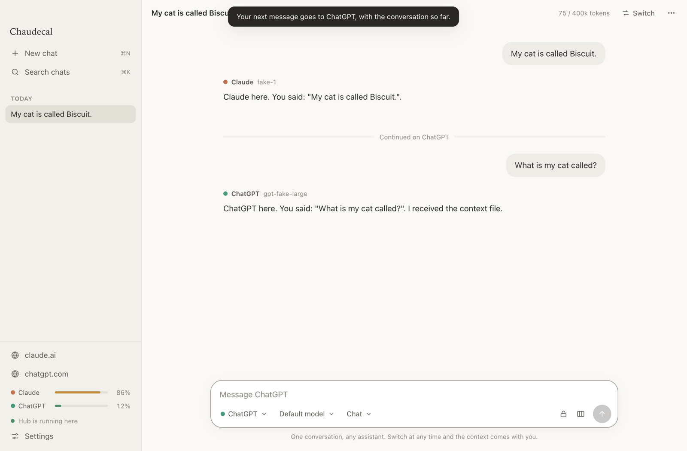
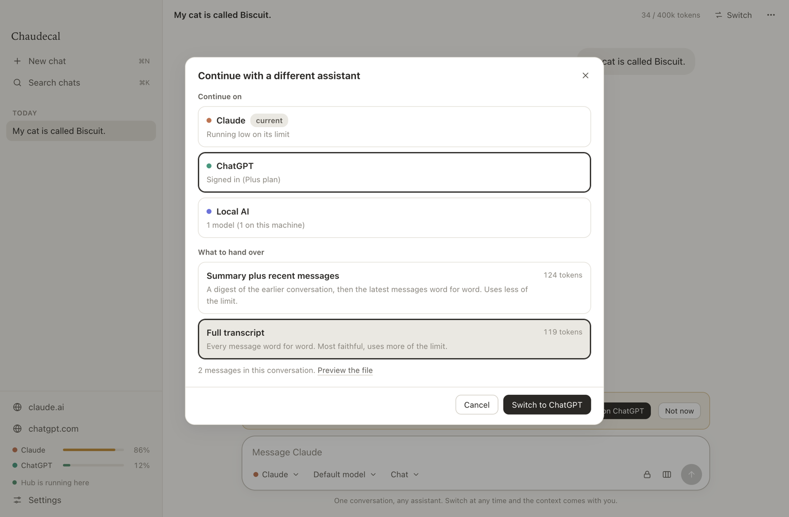
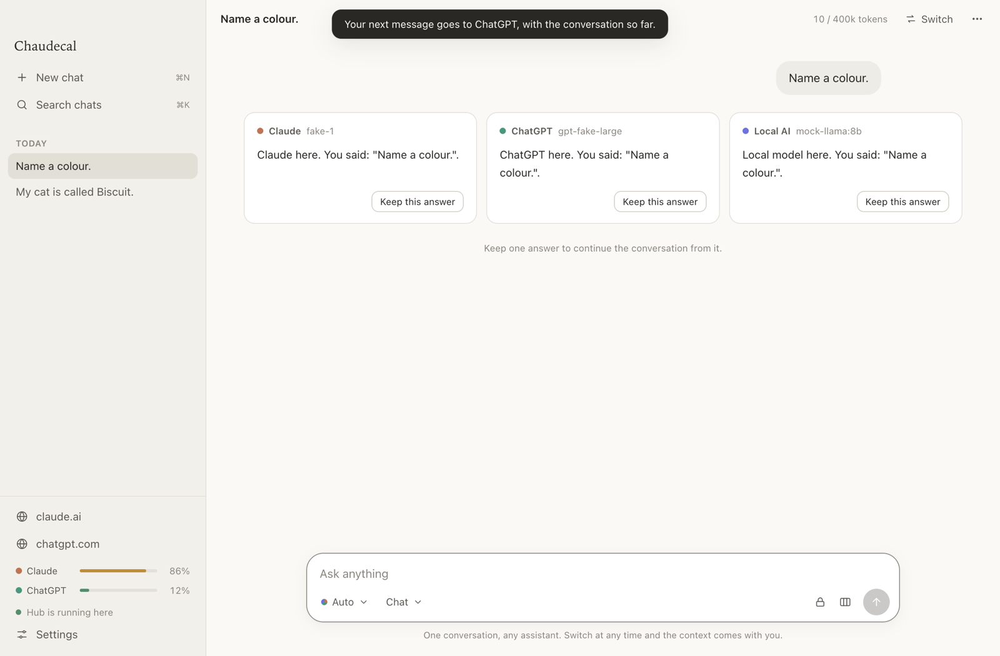
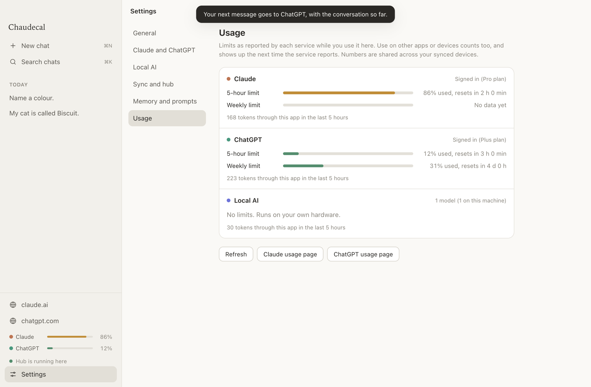

# Chaudecal AI

One desktop app for Claude, ChatGPT and local AI, on Mac and Windows. Conversations sync between your machines, and any conversation can move from one assistant to another without losing its context.



## What it does

- **One chat, three assistants.** Pick Claude, ChatGPT or a local model for each message, or leave it on Auto and let the app choose.
- **Uses your existing plans.** Claude runs through your Claude Pro sign-in and ChatGPT runs through your ChatGPT Plus sign-in. No API keys and no extra bills.
- **Context that travels.** Every conversation keeps two running context files up to date: a summary with the recent messages, and the full transcript. Switch assistants at any time and choose which one to hand over.
- **Limit warnings.** The app tracks the 5 hour and weekly limits for both plans. When one passes the threshold you set (80% by default), a banner offers to continue on the other assistant with one click.
- **Local AI on your PC.** Any OpenAI compatible runtime works, with presets for Ollama and LM Studio. The Mac reaches the models on the PC through the hub, so the PC's graphics card does the work.
- **Sync.** The PC runs a small always-on hub. The Mac keeps a full offline copy and catches up when it reconnects. Works at home and away over Tailscale.
- **Compare.** Send one message to several assistants side by side and keep the answer you like.
- **Search everything.** One search across every conversation from every assistant.
- **Shared memory and prompts.** Notes about you and saved prompts that every assistant receives, so you never repeat yourself.
- **The real websites, built in.** claude.ai and chatgpt.com open as tabs inside the app for anything the unified chat does not cover (image generation, voice, projects, artifacts, account settings). A web chat can be brought into the unified chat.
- **Agent work.** Chat, Plan, Edit and Auto modes control whether the assistant may read and change files in a folder you choose.

| Switching assistants | Comparing answers | Usage |
| --- | --- | --- |
|  |  |  |

The screenshots come from the automated test, which uses stand-in assistants, so the replies and numbers in them are not real.

## How it connects, honestly

Neither $20 plan includes a public API, so the app does not talk to Anthropic or OpenAI directly. It drives the official command line tools that your plans already include:

- **Claude** runs through [Claude Code](https://claude.com/claude-code). Your Claude Code settings, plugins, MCP servers and skills all apply.
- **ChatGPT** runs through the [Codex CLI](https://developers.openai.com/codex/cli), which also ships inside the ChatGPT desktop app.

Both tools sign in with your subscription and count against the same limits as the official apps. The app removes API key variables from their environment so they always use the subscription sign-in.

Two things follow from this. The model list for each assistant is whatever its command line tool offers, which is close to the official app but not always identical. And if either company changes what its tool allows, parts of this app may need updating.

## Install

Every push to `main` builds installers automatically. Download the latest from the [Releases page](https://github.com/Doggo252/chaudecal-ai/releases).

| System | File |
| --- | --- |
| Windows | `Chaudecal-AI-<version>-windows-setup.exe` |
| Mac with Apple silicon | `Chaudecal-AI-<version>-mac-arm64.dmg` |
| Mac with Intel | `Chaudecal-AI-<version>-mac-x64.dmg` |

The builds are not signed with a paid developer certificate, so both systems warn the first time.

**Mac.** Drag the app to Applications and open it. macOS will refuse. Open System Settings, go to Privacy & Security, scroll down and click "Open Anyway". If that button does not appear, run this once:

```bash
xattr -dr com.apple.quarantine "/Applications/Chaudecal AI.app"
```

**Windows.** SmartScreen shows "Windows protected your PC". Click "More info", then "Run anyway".

## Set up

### 1. Sign in to Claude and ChatGPT (on each machine)

Install the two command line tools, then sign in once.

```bash
claude auth login
```

```bash
codex login
```

On a Mac with the ChatGPT desktop app installed, the app finds the Codex tool inside it automatically. Open Settings, then "Claude and ChatGPT", to check that both show as signed in. The same page has sign-in buttons that run these commands for you.

### 2. Make the PC the hub

On the PC, open Settings, then "Sync and hub", and turn on "This machine is the hub". Windows Firewall will ask whether to allow the app on your network. Allow it on private networks.

The page then shows a pairing code and the addresses the hub can be reached at. Treat the pairing code like a password: anyone with the code and network access to the PC can read your chats.

Keep the app open on the PC (minimized is fine). On Windows, closing the window quits the app and stops the hub.

### 3. Connect the Mac

On the Mac, open Settings, then "Sync and hub".

- **At home:** click "Find the hub on this network", pick the PC, and enter the pairing code.
- **Home and away:** use the PC's Tailscale address instead, for example `http://my-pc:47600` or `http://100.x.y.z:47600`. Tailscale works on your home network too, so this one address covers both cases.

The status line shows when the two machines are in sync. Changes made offline are sent the next time the Mac reaches the hub.

### 4. Local AI on the PC

Install [LM Studio](https://lmstudio.ai) or [Ollama](https://ollama.com) on the PC and download a model. The app looks for both on their usual ports (1234 and 11434) and lists what it finds under Settings, "Local AI". Any other OpenAI compatible server can be added there by address.

The Mac does not need to reach these programs directly. It asks the hub, and the hub passes the request to the runtime on the PC. They only need to listen on the PC itself.

Notes for a Radeon RX 9070 XT (16 GB):

- LM Studio is the easier first choice on AMD cards because its Vulkan engine works without extra setup. In LM Studio, open the Developer tab and start the server.
- Ollama's support for AMD cards depends on the version. After loading a model, run `ollama ps` and check that it says GPU, not CPU.
- Choose a model whose download is under about 13 GB so it fits in graphics memory with room left for the conversation. Larger models still run, but spill into system memory and slow down a lot.
- The app assumes a 16,000 token window for local models. If you load a model with a larger window, raise "Context window" under Settings, "Local AI" to match.

Turn on "Keep summaries up to date with local AI" to have a local model write the running summaries. This costs nothing against either plan. Without it the app builds summaries by extracting key lines.

## Using it

- **Choosing an assistant.** The picker in the message box sets the assistant and model. Auto keeps a conversation with the assistant it is already using, sends coding work to Claude and general questions to ChatGPT, answers short questions locally when you allow it, and steers away from an assistant that is close to its limit.
- **Modes.** Chat is conversation only with web lookups. Plan lets the assistant read a folder and propose changes. Edit lets it change files in the folder. Auto also lets it run commands. Choose the folder with the folder button in the message box.
- **Switching.** Click the switch button at the top of a conversation, pick the assistant, and choose what to hand over: the summary with recent messages (smaller, faster) or the full transcript (complete). The receiving assistant gets the file with your next message.
- **The context files.** Both files are plain Markdown and are rewritten after every reply. Open them from the conversation menu to paste into anything else. The largest file is capped by the context budget in Settings (400,000 tokens by default) and by what the receiving model can take.
- **Private chats.** A private conversation only ever uses local AI.
- **Shortcuts.** New chat is Cmd or Ctrl+N. Search is Cmd or Ctrl+K. Settings is Cmd or Ctrl+comma.

## Limits of this version

- Images and voice are available through the built-in website tabs, not through the unified chat. The message box does not take attachments yet.
- Claude asks for permission after a turn, not during it. If Claude was blocked from doing something, a card offers "Allow and continue". ChatGPT asks live.
- Agent work runs on the machine you are sitting at. The Mac cannot yet start Claude or ChatGPT agent work on the PC. Local AI is the exception and always runs on the PC.
- Local models chat only. They do not edit files or run commands.
- There is no automatic update. Download the newer installer from Releases.
- Sign-ins inside the website tabs are separate from the command line sign-ins and stay on each machine.
- The Windows build is produced and tested automatically, but it has not been used day to day yet. Please report anything odd.

## Development

Requires Node 24 or newer.

```bash
npm install
```

```bash
npm run dev
```

| Command | What it does |
| --- | --- |
| `npm run typecheck` | Type checks everything |
| `npm test` | Unit tests against stand-in services |
| `npm run build` | Builds the app into `out/` |
| `npm run e2e` | Starts two copies of the built app (a hub and a client) and drives the real window |
| `npm run dist:mac` | Builds the Mac installers into `release/` |
| `npm run dist:win` | Builds the Windows installer into `release/` |

The tests never contact Claude or ChatGPT. They use small stand-in programs in [tests/fakes](tests/fakes) that speak the same protocols. To run the two tests that use your real sign-ins:

```bash
CHAUDECAL_LIVE=chatgpt,claude npm test
```

The design, the architecture and the roadmap are in [docs/PLAN.md](docs/PLAN.md).

## License

[MIT](LICENSE)
