# Chaude

One desktop app for Claude, ChatGPT and local AI, on Mac and Windows. (It used to be called Chaudecal AI.) Conversations sync between your machines, and any conversation can move from one assistant to another without losing its context.


## What it does

The sidebar has two tabs:

- **Chats** are regular chats on claude.ai and chatgpt.com. Chaude draws them in its own look, but they live on the website, so they show up in the Claude and ChatGPT apps on every device, with the website's own models, memory and tools. Your existing chats from both sites are here too, and carry on where they are.
- **Code** chats work on your computer with Claude Code, Codex or a local model: they read and change files, run commands, and sync between the devices that run Chaude. Your Claude Code and Codex sessions from each computer (from a terminal, an editor, or the Claude and ChatGPT desktop apps) show up here and carry on in the same session.

- **One chat, three assistants.** Pick Claude, ChatGPT or a local model for each message, or leave it on Auto and let the app choose.
- **Uses your existing plans.** Claude runs through your Claude Pro sign-in and ChatGPT runs through your ChatGPT Plus sign-in. No API keys and no extra bills.
- **Context that travels.** Every conversation keeps two running context files up to date: a summary with the recent messages, and the full transcript. Switch assistants at any time and choose which one to hand over.
- **Limit warnings.** The app tracks the 5 hour and weekly limits for both plans. When one passes the threshold you set (80% by default), a banner offers to continue on the other assistant with one click.
- **Local AI on your PC.** Any OpenAI compatible runtime works, with presets for Ollama and LM Studio. The Mac reaches the models on the PC through the hub, so the PC's graphics card does the work.
- **Remote work.** Type on the Mac, and the Claude or ChatGPT on the PC does the work, in a folder on the PC. It keeps going while the Mac sleeps, and the result is there when you come back.
- **Sync.** The PC runs a small always-on hub. The Mac keeps a full offline copy and catches up when it reconnects. Works at home and away over Tailscale.
- **Compare.** Send one message to several assistants side by side and keep the answer you like.
- **Search everything.** One search across every conversation from every assistant.
- **Shared memory and prompts.** Notes about you and saved prompts that every assistant receives, so you never repeat yourself.
- **Attachments.** Attach, paste or drop images, PDFs and text files. Images go to whichever assistant is answering and follow the conversation when it switches. A PDF's text is read by the app, so every assistant can use it, local models included. Everything syncs between your machines.
- **Second opinion and branching.** One click asks another assistant to review an answer. Any answer can be branched into a separate conversation to try a different direction.
- **Notifications.** Send a long task, switch to another app, and get a notification when the reply is ready or when the assistant has stopped to ask you something. Clicking it opens that conversation.
- **Your own look.** Light, dark or matching the system, an accent color (seven presets or any color you pick), and four text sizes.
- **Artifacts.** Web pages, React components, SVG images, Mermaid diagrams, documents and programs that an assistant writes open in a panel beside the conversation, with a live preview, versions, copy and download. They work with Claude, ChatGPT and local models alike.
- **Your existing chats and projects.** Your history on claude.ai and chatgpt.com comes into the app, including archived chats, Claude artifacts, and your projects (Claude's with their instructions and files, ChatGPT's with their instructions), and stays up to date. Sign in to each site once under Settings, "Claude and ChatGPT": the site's own sign-in page opens in a small window and closes by itself. The sites are never shown inside the main window.
- **Use this computer from a regular chat.** The computer switch in a regular chat's message box does that one message here, with Claude Code or Codex, in a folder you choose. It is marked "On this computer" and stays in Chaude; the website hears about it in a short note with your next message.
- **Real model lists.** The model picker shows the models your plan offers, by name and version, with a line on what each is for, and older ones under "More models". Code chats also have a thinking level, from Quick to Deepest.
- **Commands.** Type "/" for a list. /usage shows how much of each plan is used and when it resets; /new, /search and /settings do what they say. In Claude code chats, Claude Code's own commands (like /compact) are listed too.
- **Tools for both assistants (MCP).** Add a tool server once, for example for GitHub, your notes or a database, and Claude and ChatGPT can both use it. The list syncs between your machines.
- **Agent work.** Chat, Plan, Edit and Auto modes control whether the assistant may read and change files in a folder you choose. When Claude or ChatGPT wants to do something outside what the mode allows, it stops and asks, and you answer with one click.
- **See what the assistant did.** Its plan shows as a checklist that ticks itself off, its steps are grouped ("Ran 3 commands", "Edited 2 files +12 −3"), and every file edit opens to show the lines it changed.
- **Projects.** Give a group of chats their own instructions and files (text files, documents and PDFs). Every chat in the project gets them, whichever assistant answers.
- **Scheduled tasks.** A prompt that runs by itself every hour, day, weekday or week, or once, into its own chat. Run it on the hub PC and it keeps going while the Mac is closed.
- **On your phone.** The hub PC can serve Chaude to any browser on your home network or over Tailscale. Open it on your phone, enter the pairing code once, and add it to your home screen: it is the same app, with a phone layout, running its assistants on the PC.
- **Quick ask and screenshots.** Option+Space (Alt+Space on Windows) opens a small box over whatever you are doing; type a question and it starts a new chat. The screen button in the message box attaches a screenshot of your screen or of one window.
- **Export.** Save any chat as Markdown or as one web page that opens in any browser.
- **Setup in four steps.** The first time Chaude opens (and after erasing everything), a short setup asks which computer this is (the main computer, one that connects to it, or only this one), signs you in to claude.ai and chatgpt.com and brings in every chat and project, turns on your Claude Code and Codex sessions, and shows the pairing code for your other computers. Every step can be skipped, and "Run setup" in Settings, General brings it back.
- **Code projects by folder.** Code chats are sorted by the folder they work in, each folder as its own project, the way the Claude Code and Codex apps list them. A folder of the same name on the Mac and the PC is one project. Chat projects and code projects are kept apart.
- **Show one assistant only.** The menu under the Chaude name can show only Claude, only ChatGPT or only local chats, so the app looks and works like that assistant's own app. Every chat and project is marked with its assistant's icon.
- **Renames follow.** A chat renamed on claude.ai, chatgpt.com, in Claude Code or in Codex gets its new name here too, unless you renamed it in Chaude yourself.
- **Files in regular chats.** Files from your computer go to claude.ai and chatgpt.com with your message: pictures as pictures, and the text of documents and PDFs alongside.
- **Chats and Artifacts pages.** As on claude.ai, the sidebar has a Chats page with every chat in one searchable list, and an Artifacts page with every page, document, diagram and piece of code the assistants wrote, from every chat. Click one to open it in its chat.
- **Start over.** Settings, General has "Erase everything", which clears every chat, project and import from Chaude on all your synced devices (nothing on the websites or in your Claude Code and Codex sessions is touched), and "Uninstall", which removes the app and its data from this computer.
- **Research, pictures and forms.** Research mode has the assistant search the web widely and write a report with its sources. ChatGPT makes pictures on your plan. An assistant can ask you several questions at once as a small form. Artifacts can be edited by hand and saved as a new version.
- **Math, editing and voice.** Formulas are drawn properly. Any earlier question can be edited and asked again. Answers can be read aloud, and you can dictate a message.

| Switching assistants | Comparing answers |
| --- | --- |
|  |  |

| Attachments | Usage |
| --- | --- |
| 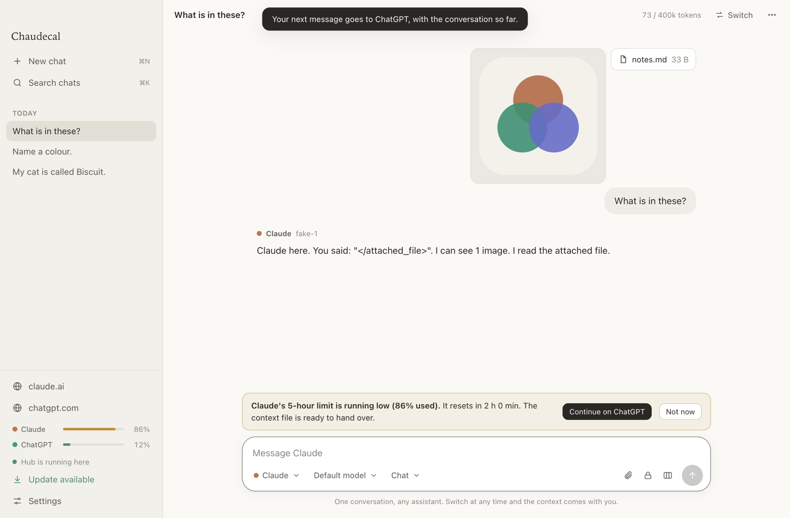 |  |

| Working on the hub from another device | Asking before it acts |
| --- | --- |
| 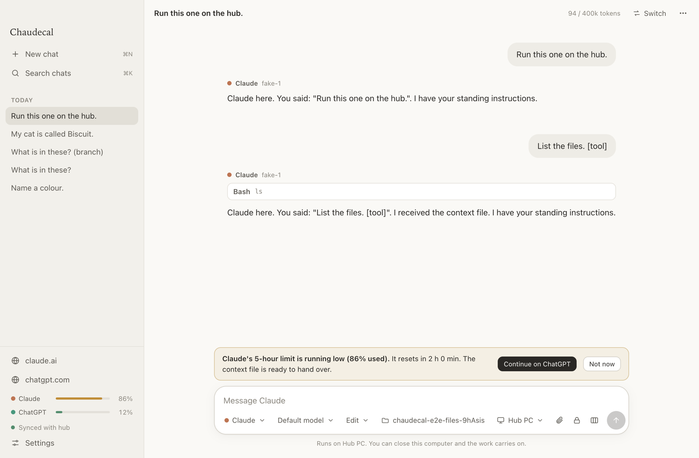 | 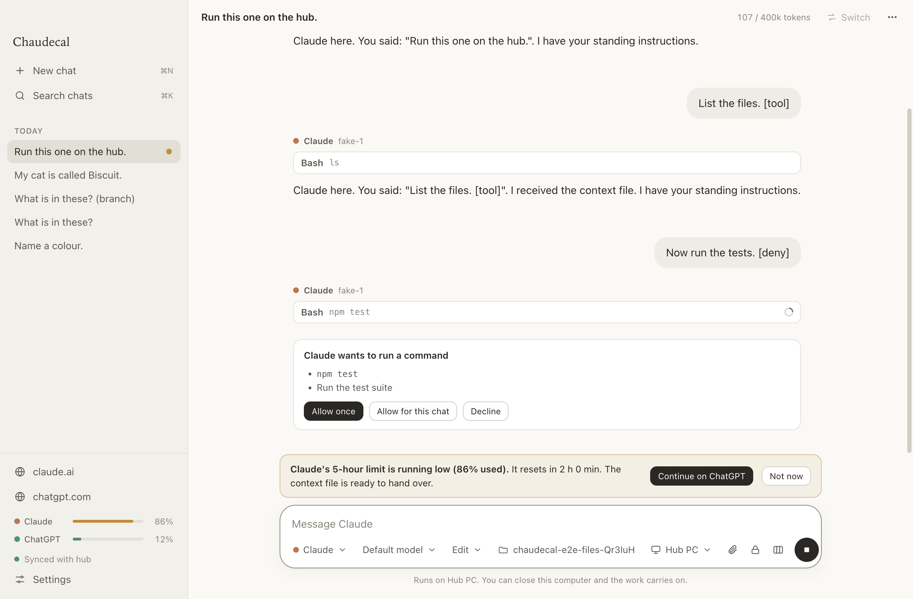 |

| Choosing a folder on the hub | Tool servers |
| --- | --- |
| 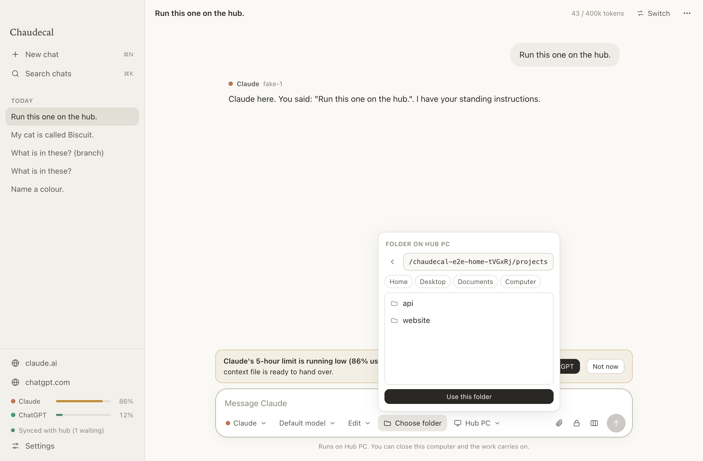 | 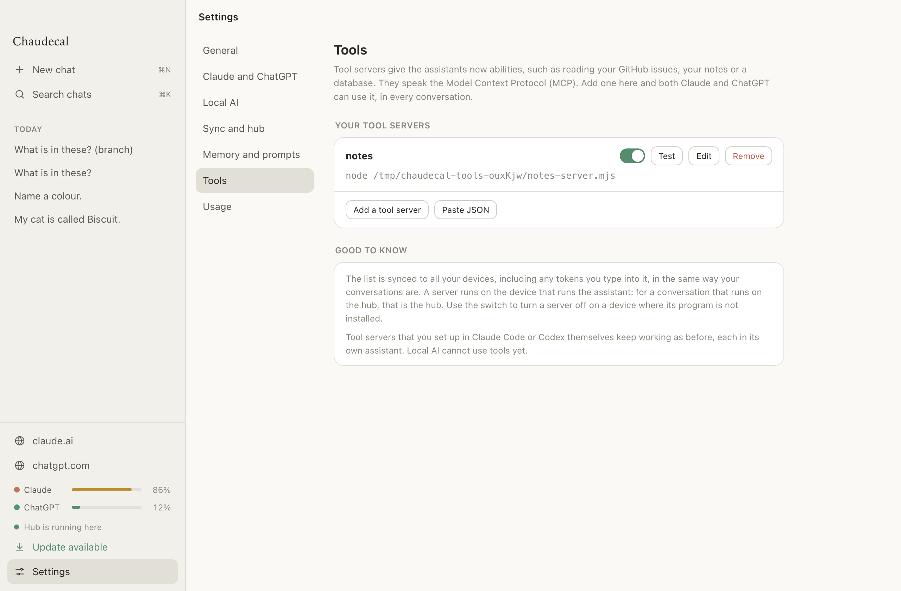 |

| Asking before a tool is used | Theme, accent color and text size |
| --- | --- |
| 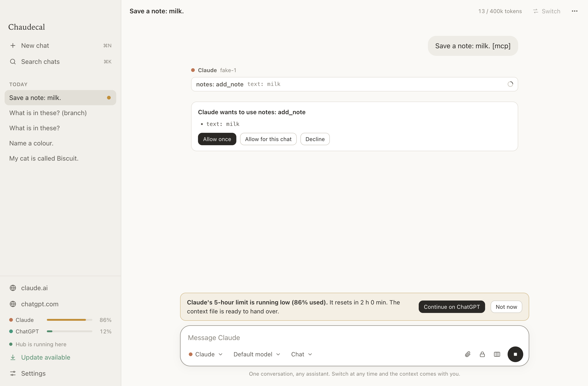 | 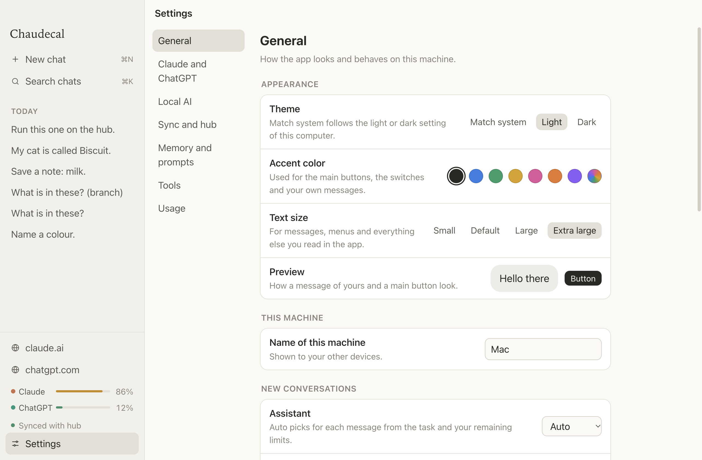 |

| A checklist, grouped steps and a diff | Artifacts |
| --- | --- |
| 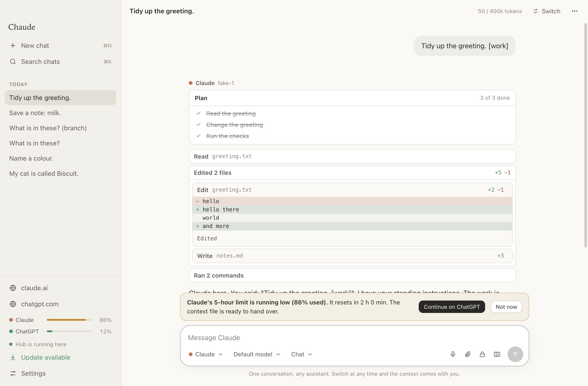 | 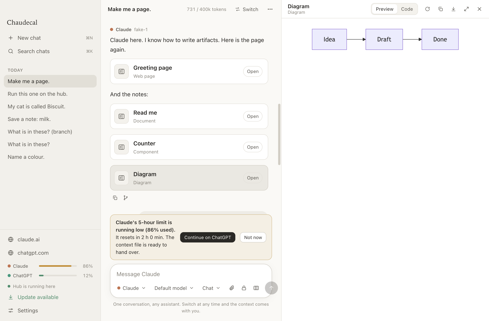 |

| Versions, and a preview that ran into an error | |
| --- | --- |
| 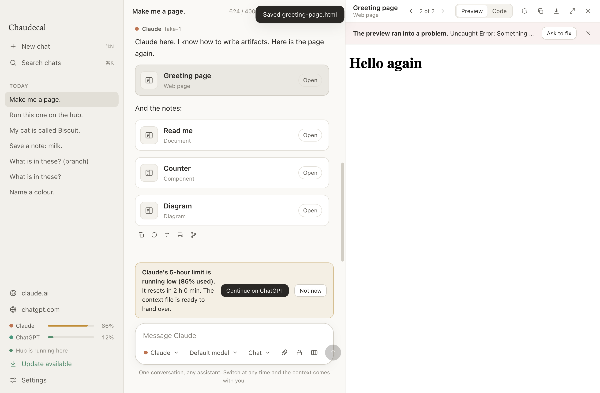 | |

| On a phone | A project |
| --- | --- |
| 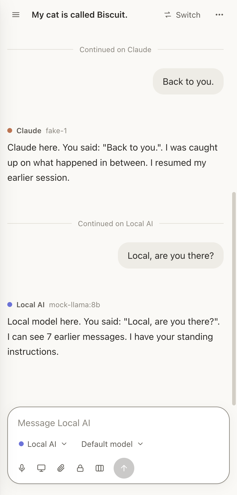 | 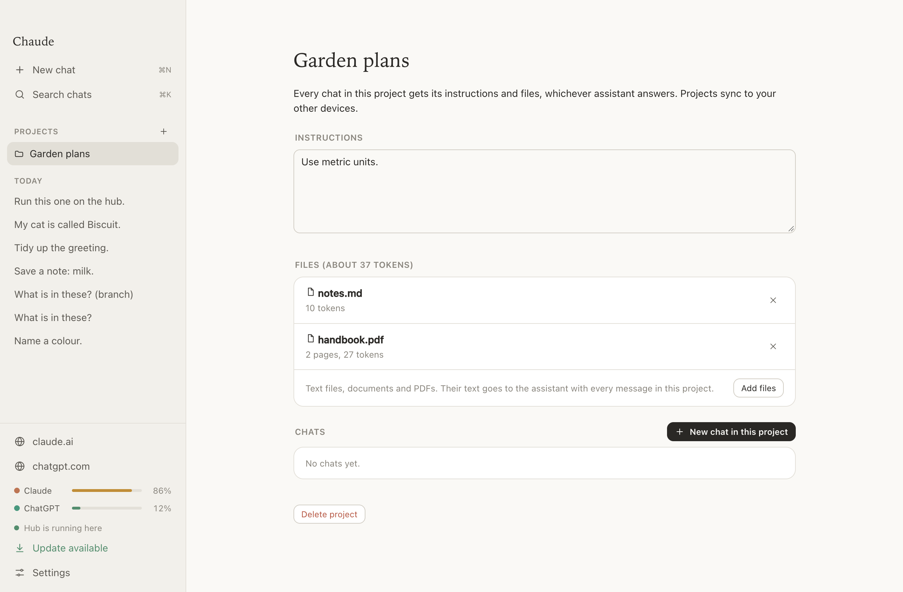 |

| A scheduled task | A form in a reply |
| --- | --- |
| 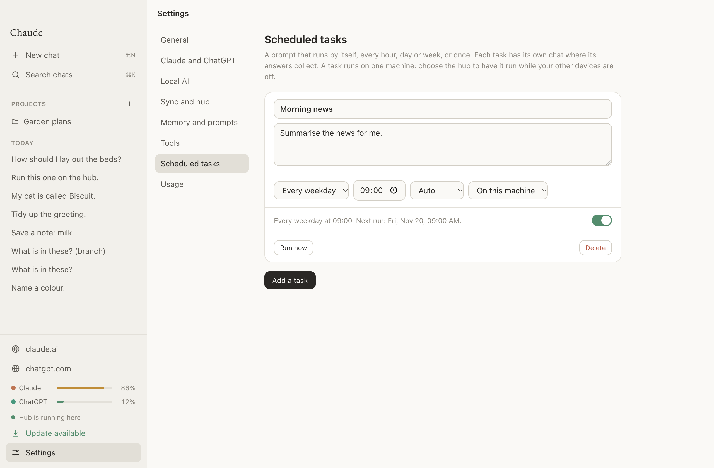 | 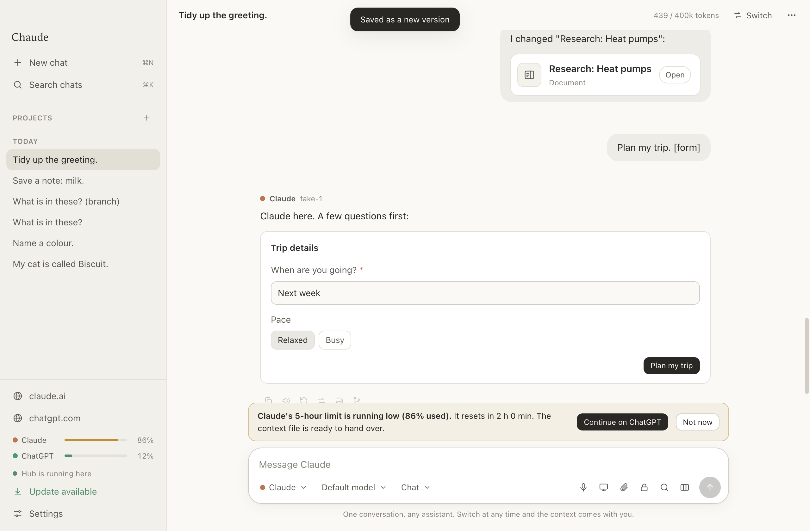 |

| A chat brought in from claude.ai | Bringing in your chats |
| --- | --- |
| 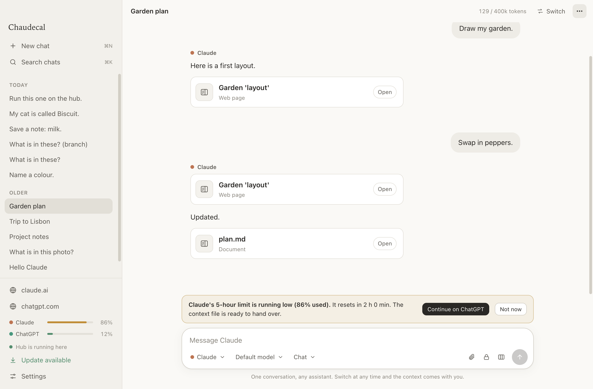 | 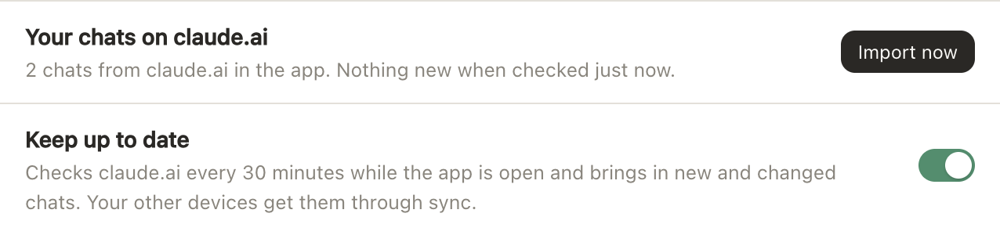 |

The screenshots come from the automated test, which uses stand-in assistants, so the replies and numbers in them are not real.

## How it connects, honestly

Neither $20 plan includes a public API, so the app does not talk to Anthropic or OpenAI directly. It drives the official command line tools that your plans already include:

- **Claude** runs through [Claude Code](https://claude.com/claude-code). Your Claude Code settings, plugins, MCP servers and skills all apply, in addition to the tool servers you add in this app.
- **ChatGPT** runs through the [Codex CLI](https://developers.openai.com/codex/cli), which also ships inside the ChatGPT desktop app.

Both tools sign in with your subscription and count against the same limits as the official apps. The app removes API key variables from their environment so they always use the subscription sign-in.

Two things follow from this. The model list for each assistant is whatever its command line tool offers, which is close to the official app but not always identical. And if either company changes what its tool allows, parts of this app may need updating.

## Install

Every push to `main` builds installers automatically. Download the latest from the [Releases page](https://github.com/Doggo252/chaudecal-ai/releases).

| System | File |
| --- | --- |
| Windows | `Chaude-<version>-windows-setup.exe` |
| Mac with Apple silicon | `Chaude-<version>-mac-arm64.dmg` |
| Mac with Intel | `Chaude-<version>-mac-x64.dmg` |

The builds are not signed with a paid developer certificate, so both systems warn the first time.

**Mac.** Drag the app to Applications and open it. macOS will refuse. Open System Settings, go to Privacy & Security, scroll down and click "Open Anyway". If that button does not appear, run this once:

```bash
xattr -dr com.apple.quarantine "/Applications/Chaude.app"
```

**Windows.** SmartScreen shows "Windows protected your PC". Click "More info", then "Run anyway".

**After that, it updates itself.** The app looks for a new version every hour and when the computer wakes up. It downloads one in the background and checks it against the checksum on the release. It then installs it by itself: when you quit Chaude, or when you have been away for 10 minutes and nothing is running. After an update while you were away, Chaude comes back as it was, so a hub that sits in the background stays in the background. To update right away, click "Restart to update" in the sidebar. To install updates only when you click, turn off "Update automatically" under Settings, "General". On a Mac, keep the app in your Applications folder: an app opened straight from the downloaded disk image cannot replace itself. Versions before 0.12 cannot update themselves: install the newest one from the release page once.

**Coming from Chaudecal AI?** Install Chaude the same way. It finds your existing chats, settings and website sign-ins by itself. Then delete the old Chaudecal AI app. On Windows, uninstall Chaudecal AI from Settings, Apps, if it is still listed.

## Set up

### 1. Sign in to Claude and ChatGPT (on each machine)

Install the two command line tools, then sign in once.

```bash
claude auth login
```

```bash
codex login
```

On a Mac with the ChatGPT desktop app installed, the app finds the Codex tool inside it automatically. Open Settings, then "Claude and ChatGPT", to check that both show as signed in. The same page has sign-in buttons that run these commands for you.

### 2. Make the PC the hub

On the PC, open Settings, then "Sync and hub", and turn on "This machine is the hub". Windows Firewall will ask whether to allow the app on your network. Allow it on private networks.

The page then shows a pairing code and the addresses the hub can be reached at. Treat the pairing code like a password: anyone with the code and network access to the PC can read your chats.

On the hub PC, closing the window does not stop the app. It stays in the system tray next to the clock so your other devices can keep syncing. Right-click the tray icon to quit. To have the hub come back after a restart, turn on "Start when I sign in to this computer" under Settings, "General".

### 3. Connect the Mac

On the Mac, open Settings, then "Sync and hub".

- **At home:** click "Find the hub on this network", pick the PC, and enter the pairing code.
- **Home and away:** use the PC's Tailscale address instead, for example `http://my-pc:47600` or `http://100.x.y.z:47600`. Tailscale works on your home network too, so this one address covers both cases.

The status line shows when the two machines are in sync. Changes made offline are sent the next time the Mac reaches the hub.

**If the Mac says the hub is not reachable but the PC says it is running,** macOS is probably keeping Chaude off your home network. The Mac is supposed to ask the first time, but it does not always ask an app without a paid signature. Open System Settings, Privacy & Security, Local Network, and turn on Chaude. Chaude spots this case and shows an "Open settings" button that goes straight there.

### 4. Local AI on the PC

Install [LM Studio](https://lmstudio.ai) or [Ollama](https://ollama.com) on the PC and download a model. The app looks for both on their usual ports (1234 and 11434) and lists what it finds under Settings, "Local AI". Any other OpenAI compatible server can be added there by address.

The Mac does not need to reach these programs directly. It asks the hub, and the hub passes the request to the runtime on the PC. They only need to listen on the PC itself.

Notes for a Radeon RX 9070 XT (16 GB):

- LM Studio is the easier first choice on AMD cards because its Vulkan engine works without extra setup. In LM Studio, open the Developer tab and start the server.
- Ollama's support for AMD cards depends on the version. After loading a model, run `ollama ps` and check that it says GPU, not CPU.
- Choose a model whose download is under about 13 GB so it fits in graphics memory with room left for the conversation. Larger models still run, but spill into system memory and slow down a lot.
- The app assumes a local model can read 16,000 tokens at once. If you load a model with a larger context length, set "How much a local model can read at once" under Settings, "Local AI" to match. Claude and ChatGPT need nothing: the app works out how much their models read from the model itself.

Turn on "Keep summaries up to date with local AI" to have a local model write the running summaries. This costs nothing against either plan. Without it the app builds summaries by extracting key lines.

### 5. Run assistants on the PC from the Mac (optional)

This lets the Mac hand work to the PC: the PC's own Claude Code and Codex do it, using the PC's sign-ins and files.

1. On the PC, open Settings, "Sync and hub", and turn on "Let my other devices run assistants on this machine".
2. On the Mac, a "Runs on" button appears in the message box within a minute. Choose the PC there for a conversation, or turn on "Run new conversations on the hub" under Settings, "Sync and hub".
3. For Plan, Edit or Auto mode, click the folder button to choose a folder on the PC. It opens on the PC's home folder: click a folder to go into it, use the arrow to go back up, or jump to Desktop, Documents or a drive. You can also type a full path, for example `C:\Users\you\project`. Then click "Use this folder".

Replies stream to the Mac as they are written. If the Mac goes to sleep or offline, the PC carries on and the finished reply syncs when the Mac is back. When Claude or ChatGPT asks for permission, the question appears on the Mac, and on the PC's own screen too. Answering on either one clears it on both.

**Read this before turning it on.** With this setting on, anyone who has the pairing code and can reach the PC can see the names of its folders, edit files and run commands on it. Keep the hub on your home network and Tailscale, never forward its port to the internet, and make a new pairing code if the old one may have leaked. The setting is off by default.

### 6. Bring in your existing chats (optional)

The setup that opens on a new install does this in one step. To do it by hand:

1. Open Settings, then "Claude and ChatGPT", and click "Sign in to claude.ai". The site's own sign-in page opens in a small window; sign in the way you would in a browser, and the window closes by itself. Do the same for chatgpt.com.
2. Under each one, click "Import now" next to "Your chats on claude.ai" (or chatgpt.com). The first run can take a few minutes if you have many chats; the row shows how far it has got.
3. Turn on "Keep up to date" to have the app check for new and changed chats every 30 minutes while it is open.

You only need to do this on one machine. The chats sync to your other devices like any other conversation. If you do it on both, nothing is duplicated.

An imported chat is a regular chat: carrying it on here sends your message through the website, so it continues the very same chat there. "Open on claude.ai" (or chatgpt.com) in the conversation's menu opens the original in your browser.

### 7. Use it on your phone (optional)

1. On the hub PC, open Settings, "Sync and hub", and turn on "Use Chaude from a phone or a browser".
2. The page lists the addresses to open, ending in `/app/`. On your phone, open one in Safari or Chrome: the one with your home network address at home, or the Tailscale one (starting `100.`) anywhere, with Tailscale on the phone.
3. Enter the pairing code shown on the same page. The phone remembers it.
4. In Safari, tap Share, then "Add to Home Screen" (in Chrome, the menu, then "Add to Home screen"), so it opens like an app.

On the phone it is the same app: your chats, projects and artifacts, with the sidebar behind the menu button. Messages run on the PC, so the PC has to be on. Settings belong to each machine and are changed on the PC itself. Dictation in a phone browser needs a secure (https) address, which a plain home network address is not; use the phone keyboard's own microphone instead.

### 8. Add tool servers (optional)

A tool server gives the assistants a new ability: reading your GitHub issues, searching your notes, querying a database. Tool servers speak the Model Context Protocol (MCP), and there are ready-made ones for many services.

Open Settings, then "Tools".

- **Paste JSON.** Most tool servers come with a short piece of JSON in their instructions (it starts with `"mcpServers"`). Click "Paste JSON", paste it, and click "Add".
- **Or fill in the form.** Click "Add a tool server", give it a short name, and either type the command that starts it (for example `npx -y @modelcontextprotocol/server-filesystem ~/Documents`) or the web address of a hosted one. Tokens go in the box below: `NAME=value` lines for a command, `Authorization: Bearer your-token` for a web address.
- **Or pick one from the list.** "Ready to add" has Notion, Linear and GitHub (hosted), and a browser the assistant can drive, your Documents folder and a memory (these three run as programs and need Node.js). One click adds it.
- **Sign in.** A hosted server that asks for a sign-in shows a "Sign in" button. Click it, approve in your browser, and the server is ready; the app renews the sign-in by itself. A server that cannot be signed in to this way (GitHub) takes a token in the headers instead.
- **Test it.** "Test on this device" starts the server (or calls the address) and lists the tools it offers, or says what went wrong.

From then on both Claude and ChatGPT can use the server in every conversation, in every mode. Before a tool is used you get the same question card as for a command, naming the server and the tool and showing what is sent to it. Claude asks about every tool. ChatGPT asks about the tools that change something and uses read-only ones directly. Turn on "Let its tools run without asking" for a server you trust.

The list syncs to your other devices, tokens included. A server runs on the machine that runs the assistant, so for a conversation that runs on the hub PC, the server's program has to be installed on the PC. Each device has its own switch per server, for a program that is only installed on one of them.

## Using it

- **Choosing an assistant.** The picker in the message box sets the assistant and model. Auto keeps a conversation with the assistant it is already using, sends coding work to Claude and general questions to ChatGPT, answers short questions locally when you allow it, and steers away from an assistant that is close to its limit.
- **Modes.** Chat is conversation only with web lookups. Plan lets the assistant read a folder and propose changes. Edit lets it change files in the folder. Auto also lets it run commands. Choose the folder with the folder button in the message box.
- **Permission questions.** When an assistant wants to go beyond its mode (run a command in Edit mode, for example), the reply pauses and a card shows exactly what it wants to do. "Allow once" lets that one action through. "Allow for this chat" also stops it asking again for the same thing in this conversation. "Decline" tells the assistant no, and it carries on without it.
- **Switching.** Click the switch button at the top of a conversation, pick the assistant, and choose what to hand over: the summary with recent messages (smaller, faster) or the full transcript (complete). The receiving assistant gets the file with your next message.
- **The context files.** Both files are plain Markdown and are rewritten after every reply. Open them from the conversation menu to paste into anything else. The largest file is capped by what the receiving model can read at once.
- **Attachments.** Use the paperclip, paste a screenshot, or drop files on the message box. Images can be PNG, JPEG, GIF or WebP up to 8 MB. Text files (code, Markdown, CSV and so on) are read into the message, so they travel in the context file. A PDF up to 32 MB is turned into text page by page and then travels the same way. When a conversation moves to another assistant, its four most recent images are sent along.
- **Second opinion.** Hover over the latest answer and click the speech bubbles. Another assistant with room left reads the conversation and reviews the answer. Your next message goes back to the assistant you were using.
- **Branching.** Hover over any answer and click the branch icon. The conversation up to that answer is copied into a new one, and the original is left as it was.
- **Projects.** Click the + next to "Projects" in the sidebar. Name the project, write its instructions, and add files with "Add files". "New chat in this project" starts a chat in it; an existing chat moves into a project from its menu (the three dots at the top). The project's name shows at the top of its chats. Local models get a shorter cut of the files, to fit their smaller memory.
- **Scheduled tasks.** Under Settings, "Scheduled tasks", click "Add a task", write what the assistant should do each time, and choose when it runs and on which machine. "On the hub" runs it on the PC whichever device you set it up on, so it keeps running while the Mac is closed. Each task's answers collect in its own chat, and you get the usual notification when one is ready. "Run now" tries it straight away. A run missed while the app was closed happens once when it opens again.
- **Quick ask.** Press Option+Space on a Mac (Alt+Space on Windows) from any app. A small box opens; type a question and press Enter, and it starts a new chat in Chaude with the assistant you use by default. Esc closes the box. Turn it off under Settings, "General".
- **Screenshots.** The screen button in the message box lists your screens and open windows. Pick one and its picture is attached to your message. On a Mac, the first time asks for permission under System Settings, Privacy & Security, Screen Recording; allow Chaude and open it again.
- **Export.** From a chat's menu, "Export as a web page" saves one file that opens in any browser, with its formatting and formulas, ready to send to someone. "Export as Markdown" saves the plain text.
- **Editing a question.** Hover over any of your messages and click the pencil. Change it and press Send: the answers after it are replaced by a new answer to the changed question. An assistant that saw the old version is given the conversation afresh, so it does not answer from the old one.
- **What the assistant did.** In Plan, Edit and Auto modes, Claude's to-do list and ChatGPT's plan show as a checklist at the top of the answer. Steps of the same sort are grouped: click a group to see each step, and click a file edit to see the lines it removed and added.
- **Math.** Formulas written as `$...$`, `$$...$$`, `\(...\)` or `\[...\]` are drawn as math. Prices such as "$5 and $10" stay text.
- **Research.** Click the magnifying glass in the message box before sending. The assistant searches the web from several angles, reads the best sources, and writes a report as a document artifact with numbered sources, then a short answer. In Auto, research goes to Claude (or ChatGPT if Claude is not available), since local AI cannot search the web. It takes longer and uses more of your plan than a normal question.
- **Pictures.** Ask ChatGPT for a picture ("draw...", "make an image of...") and it appears in the answer; Save keeps a copy. Pictures sync with the conversation. This uses your ChatGPT plan's image allowance.
- **Editing an artifact.** In the panel's Code view, click Edit, change it, and click "Save as new version". Your version appears as a message of yours and becomes the newest version; the assistant sees it next time you write, so changes you ask for after that start from your edit.
- **Forms.** When an assistant needs several answers or wants you to choose, it may send a small form. Fill it in and press its button: your answers go back as your next message.
- **Read aloud and dictation.** The speaker button under an answer reads it with your computer's own voice, leaving out code and formulas. The microphone in the message box records you and turns it into text, using a speech-to-text server you set up under Settings, "Local AI" (any server that works like OpenAI's, for example one running Whisper). Without one, use your computer's own dictation in the message box: Fn twice on a Mac, Windows key + H on Windows.
- **Notifications.** They appear only while the app is not the window in front, and only on the computer the message was sent from, so the hub PC stays quiet about work you started on the Mac. The Dock icon also shows a count (on Windows the taskbar button flashes) until you look at the app. A conversation that is waiting for your answer has an amber dot in the sidebar. Private chats never show their contents in a notification. Turn it all off under Settings, "General".
- **Theme.** Under Settings, "General", choose Light, Dark or Match system, and an accent color. The accent is used for the main buttons, the send button, the switches, the text selection and a tint on your own messages. The last swatch opens a color picker for any color, and the text on it turns dark or white to stay readable. Text size has four steps, from Small to Extra large, and changes every piece of text in the app at once. The look is a setting of each machine, so the Mac and the PC can differ.
- **Artifacts.** When an assistant writes something you will want to look at or reuse, it appears in the reply as a card, and the panel beside the conversation opens by itself while it is written. Click any card to open it again. The kinds are web pages (HTML), React components (JSX or TSX, with Tailwind and npm packages), SVG images, Mermaid diagrams, Markdown documents and code in any language. Preview and Code switch between the running result and its source. When the assistant writes the same title again, it becomes a new version, and the arrows step between versions. If a preview hits an error, "Ask to fix" sends the error back to the assistant. Copy, download, and a button to let the panel fill the window are at the top. In a narrow window the panel covers the conversation instead of squeezing it; close it to go back. The app tells every assistant how to write artifacts; turn that off under Settings, "General", "Artifacts".
- **At a limit.** By default the app asks before switching. Turn on "Switch automatically at a limit" under Settings, "General" to have it carry on with another assistant by itself when a limit is hit in the middle of a reply.
- **Private chats.** A private conversation only ever uses local AI.
- **Search.** Each chat shows once in search, with its best matching line and how many messages match. Chats from claude.ai and chatgpt.com are marked, here and in the sidebar, by a colored dot (orange for Claude, green for ChatGPT).
- **Usage.** Claude's percentages come from Claude Code's own /usage command, which reads the account without asking the model, every ten minutes and after each answer. ChatGPT's come with every answer.
- **Shortcuts.** New chat is Cmd or Ctrl+N. Search is Cmd or Ctrl+K. Settings is Cmd or Ctrl+comma.

## Limits of this version

- ChatGPT makes pictures in the unified chat; Claude does not make pictures. Live voice conversations are only on the websites and in their apps.
- Only the text of a PDF is read. Pictures, charts and scanned pages inside it are not, and a PDF that is all scans is refused with a note saying so. Use claude.ai or chatgpt.com for those. A very long PDF is cut at about 200,000 characters (roughly 80 dense pages), and the message says which pages were left out.
- A local model only understands images if it is a vision model. Others will report an error or ignore the image.
- Claude asking during a reply needs a recent Claude Code. With an older one the app notices and falls back to asking afterwards: a card lists what Claude was blocked from doing and offers "Allow and continue".
- "Allow for this chat" is remembered on the machine doing the work, and for Claude it is forgotten when you choose a different folder. A long command made of several parts is asked about each time, because allowing it "for this chat" would have to allow every command.
- The folder browser for the hub shows folders only, never files, and leaves out hidden folders. To use a hidden folder, type its path.
- If the Mac disconnects while the PC is working, the PC finishes anyway. A permission question raised in the meantime waits on the PC's own screen, and the PC shows a notification about it. The Mac is not told about a reply that finished while it was disconnected.
- The first notification makes macOS ask whether to allow them. If you say no, only the Dock count is shown.
- Local models chat only. They do not edit files, run commands or use tool servers.
- Signing in through the browser works with hosted tool servers that let an app register itself, as Notion's and Linear's do (checked against their real sign-in details, though not yet with a real account). GitHub's does not, so it takes a personal access token instead. Google Drive, Gmail and Calendar have no such hosted server that an app can sign in to by itself, so connectors like claude.ai's for them are not possible here. Tool servers you added to Claude Code or Codex yourself keep working, each in its own assistant only.
- Tokens typed into a tool server are stored and synced the way conversations are: unencrypted on your disks and on your home network, encrypted over Tailscale. Give a server a token with only the access it needs.
- On Windows, a tool server started with `npx`, `npm`, `pnpm` or `yarn` is run through `cmd` automatically. This has not been tried on a real PC yet.
- The phone version is served over plain http on your home network, like sync. Over Tailscale the connection is encrypted. Anyone with the pairing code who can reach the PC can use it fully, so keep the code to yourself. It has been tested in a phone-sized browser window, not yet on a real phone.
- Quick ask and screenshots have been tested with a pretend screen; the real keyboard shortcut and a real screen capture have not been tried yet. If another app already uses Option+Space (or Alt+Space), the shortcut does not register.
- Dictation needs a speech-to-text server. Neither plan offers speech to text through the tools this app uses, and a live voice conversation like the ones on the websites is not possible here; use the claude.ai or chatgpt.com tab for that.
- Bringing in chats relies on how claude.ai and chatgpt.com load your chats in their own pages. Neither site documents this, so a change on their side can stop it working until the app is updated; the settings row then says what went wrong. The app goes slowly on purpose (a short pause between chats) so as not to strain the sites.
- Pictures in imported chats are not brought in; a note such as "[Image]" or "[Attached: file name]" marks where they were. Text files attached on claude.ai do come in. ChatGPT chats in a Team or Enterprise workspace are not brought in yet, only those in your personal account. Thinking, web searches and other tool steps are left out; the questions and answers are kept.
- A chat you delete in the app stays deleted, even though it is still on the website. A title you change in the app is kept. A message written in the app stays in the app; it is not sent to the website.
- Previews of React components and Mermaid diagrams load React, Tailwind and Mermaid from public code hosts (esm.sh and jsDelivr), so they need an internet connection. Web pages, images, documents and code work offline.
- A preview is sealed off: it cannot reach the app, your files or the internet. It may load scripts, styles and fonts only from esm.sh, jsDelivr, unpkg, cdnjs and Google Fonts. Images must be inside the artifact (inline SVG or data URLs), links in a preview do not open, and forms do not send. A page that needs to fetch data will not work in the preview; download it and open it in a browser instead.
- A React component must be a single file. Imports of project files such as `@/components/ui/...` (the shadcn/ui components that claude.ai offers) cannot be shown, and the panel says so.
- Artifacts are found in the text of replies, so an assistant that ignores the instructions writes ordinary code blocks instead. Real Claude and ChatGPT replies have not been checked with artifacts yet; the tests use a stand-in assistant.
- Updating by itself works from the first version called Chaude onwards. Older versions only say that an update exists, so install Chaude once by hand.
- The Mac update has been run for real between two packaged versions. The Windows update runs the new installer silently and has only been checked in code, not on a real PC yet. If it fails, the sidebar says so and the release page still works.
- The app's sign-ins to claude.ai and chatgpt.com are separate from the command line sign-ins and stay on each machine.
- The Windows build is produced and tested automatically, but it has not been used day to day yet. The tray icon, closing to the tray and starting at sign-in in particular have only been checked in code, not on a real PC. Please report anything odd.

## Development

Requires Node 24 or newer.

```bash
npm install
```

```bash
npm run dev
```

| Command | What it does |
| --- | --- |
| `npm run typecheck` | Type checks everything |
| `npm test` | Unit tests against stand-in services |
| `npm run build` | Builds the app into `out/` |
| `npm run e2e` | Starts two copies of the built app (a hub and a client) and drives the real windows through 45 checks. With `E2E_NET=1` it also checks that React and Mermaid previews load from the internet, and `E2E_NARROW=1` runs the artifact checks in a narrow window |
| `npm run dist:mac` | Builds the Mac installers into `release/` |
| `npm run dist:win` | Builds the Windows installer into `release/` |

The tests never contact Claude or ChatGPT. They use small stand-in programs in [tests/fakes](tests/fakes) that speak the same protocols. To run the two tests that use your real sign-ins:

```bash
CHAUDECAL_LIVE=chatgpt,claude npm test
```

Add `chatgpt-image` or `claude-image` to that list to check that an attached image is really seen. Add `claude-ask` to check that Claude really stops and asks before running a command. Add `chatgpt-mcp` or `claude-mcp` to check that the assistant really uses a tool server, after asking.

The design, the architecture and the roadmap are in [docs/PLAN.md](docs/PLAN.md).

## License

[MIT](LICENSE)
